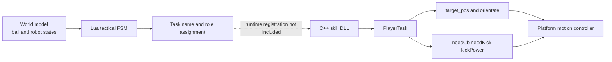
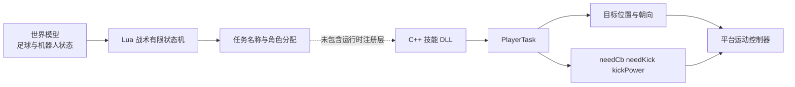

# Cooperative Robot Soccer Control with Lua and C++

[English](#english-version) | [中文](#中文版本)

## English Version

This repository contains an archived coursework implementation of a cooperative robot-soccer attack. Lua scripts schedule multi-robot tactics as finite-state machines, while C++ skill modules calculate target positions, desired orientations, and kick requests through a `PlayerTask` interface.

The archive supports source-level inspection of the passing workflow and its geometric rules. It is **not a standalone simulator or a complete rebuildable controller**: the original runtime, task-registration layer, several platform headers, build files, and compiled DLLs are not included.

## System overview



The Lua layer determines *when* a role should position, acquire the ball, pass, receive, shoot, or stop. The C++ layer determines *what local action request* should be returned for the current world state. A state transition or timeout is therefore not evidence that the physical action succeeded.

## Repository structure

```text
.
├── cpp_skills/
│   ├── getball/          # Behind-the-ball positioning and local orbit adjustment
│   ├── passball/         # Standard passing request, fixed kickPower = 30
│   ├── passball_corner/  # Corner/short-pass variant, fixed kickPower = 13
│   ├── shoot/            # Shooting variant, target y = 25, angle tolerance 0.10 rad
│   └── shoot2/           # Shooting variant, target y = -25, angle tolerance 0.25 rad
├── lua_scripts/
│   ├── 1back-1-01.lua
│   ├── 1corcer-1-02.lua
│   ├── 1corcer-1-03.lua
│   ├── 1front-2-03.lua
│   ├── 1middle-1-01.lua
│   └── kick-penalty01.lua
└── include/
    ├── PlayerTask.h      # Action-request data structure
    ├── worldmodel.h      # Read-only access to observed robot and ball states
    ├── maths.h           # Geometry helper declarations
    ├── constants.h       # Field and robot constants
    ├── vector.h          # 2D/3D vector implementation
    └── other interface and XML configuration files
```

The original Chinese folder names were normalized to ASCII directory names for portable GitHub links. Legacy GBK-encoded C++ headers and source files were converted to UTF-8 without changing program logic.

## Tactical finite-state machines

Most cooperative Lua plays use the following sequence:

```text
Beginning -> Delay_1 -> Passball_1 -> Delay_2 -> shoot -> Finish
```

Representative transition guards include:

| Transition or state | Representative condition | Meaning |
|---|---|---|
| `Beginning -> Delay_1` | receiver-to-target distance `< 13`, buffered for 30 cycles | Initial receiver positioning |
| `Delay_1 -> Passball_1` | 60 or 90 decision cycles, depending on the play | Allow the kicker to acquire and align with the ball |
| `Passball_1 -> Delay_2` | kick event, sometimes combined with a 10-cycle buffer | Move from pass request to receiving phase |
| `Delay_2 -> shoot` | ball-to-role distance `< 11` | Prepare the receiving robot for the next action |
| `shoot -> Finish` | ball enters a prescribed terminal region | End the attacking sequence |
| `Finish` | 120-cycle hold | Halt active roles and wait for later scheduling |

The scripts call platform tasks such as `getball`, `receive`, `shoot`, `shoot02`, `mydemo1`, and several `passball_corner_light*` variants. Their runtime registration and exact mapping to DLL binaries are not part of this archive.

## C++ skill interface

Each archived skill follows the same export-oriented entry pattern:

```cpp
extern "C" _declspec(dllexport)
PlayerTask player_plan(const WorldModel* model, int robot_id);
```

`WorldModel` supplies observed state, including ball position, robot position, heading, existence flags, and goalie identity. The returned `PlayerTask` contains fields such as:

| Field | Purpose |
|---|---|
| `target_pos` | Requested global target position |
| `orientate` | Requested robot heading |
| `needCb` | Ball-control-related request flag |
| `needKick` | Kick request flag |
| `kickPower` | Uncalibrated platform-specific kick command |

Several skill files export the same `player_plan` symbol. They were therefore likely intended to be built as separate DLL targets or selected through different build configurations. The original build definitions are not available here.

## Geometric rules represented in the source

### Ball acquisition

`cpp_skills/getball/getball.cpp` constructs candidate positions around the ball using a polar-to-Cartesian vector operation. Important source parameters are:

| Parameter | Value | Role |
|---|---:|---|
| Field size | `605 x 405` | Coordinate domain in `include/constants.h` |
| Candidate radius `circleR` | `30` | Radius of the local positioning circle |
| Angular increment `DetAngle` | `0.6 rad` | Positive or negative orbit adjustment |
| Final positioning distance | `7` | Candidate distance used in the final branch |

The code classifies the robot as `outOfOrbit`, `onOrbit`, or `shoot`, then assigns a target position and orientation. These are target-generation rules, not measurements of the robot's executed trajectory.

### Passing

The active standard passing condition combines:

- a ball-proximity test using a 15-unit threshold;
- a raw angular-difference threshold of `0.10 rad`;
- a fixed `kickPower` of `30` for the standard variant or `13` for the corner variant.

A distance-dependent kick-power scheme remains in commented code and is not treated as an active controller.

### Shooting

The two shooting variants request `kickPower = 127`. They differ in their prescribed target position and active angular tolerance:

| Variant | Target | Angular tolerance |
|---|---|---:|
| `cpp_skills/shoot` | `(300, 25)` before y-axis mirroring | `0.10 rad` |
| `cpp_skills/shoot2` | `(300, -25)` before y-axis mirroring | `0.25 rad` |

`kickPower` values cannot be converted to physical ball velocity without platform-specific calibration.

## Integration with the original platform

The following steps describe the expected integration conceptually; they are not a verified standalone build procedure.

1. Restore the original Windows robot-soccer SDK and runtime dependencies.
2. Expose the headers in `include/` through the path expected by the source, such as `utils/PlayerTask.h`, `utils/worldmodel.h`, and `utils/maths.h`, or update the include paths.
3. Build each required C++ skill as a separate DLL exporting `player_plan`.
4. Register each Lua task string with the corresponding compiled skill in the platform loader.
5. Place the Lua play scripts in the platform's strategy directory.
6. Run the play through the original simulator or robot-control application.

The archive does not contain enough information to verify compiler version, DLL ABI compatibility, task registration, or controller replay.

## Known limitations

- The project is a partial source archive and has no CMake, Visual Studio solution, or other build definition.
- Several dependencies referenced by `worldmodel.h`, `vector.h`, and related headers are missing.
- The DLL registration map and the implementation of the Lua `receive` task are not included.
- `is_getball` in the archived passing and shooting sources has no explicit `false` return on one control path.
- Active pass and shot guards subtract direction angles directly; they do not normalize the difference across the `-pi/pi` branch cut.
- Cycle counts are not converted to seconds because the original scheduling frequency is not documented.
- The archive contains no calibrated ball dynamics, measured velocities, success-rate dataset, or complete closed-loop replay.
- Some legacy Lua comments were already corrupted in the supplied archive and have been preserved rather than guessed.

These limitations are important when using the code as evidence for numerical analysis: the source supports the stated state-machine structure and local geometric conditions, but not claims about physical pass success or full-system reproducibility.

## Relationship to the accompanying report

This code archive accompanies the report **“Numerical Analysis of Cooperative Robot Soccer Passing Based on Finite-State Machines and Geometric Constraints.”** The report separates source-derived quantities from independently constructed numerical examples. In particular, field dimensions, local positioning parameters, distance thresholds, and angular thresholds are traceable to the archived source, while boundary-clearance assumptions, grid studies, and additional obstacle configurations are analytical extensions rather than controller outputs.

## Licensing and provenance

This repository contains archived coursework code and selected interface files from a larger robot-soccer platform. `include/vector.h` and `include/constants.h` retain copyright and GNU General Public License version 2 notices from the Carnegie Mellon University CMDragons source release. Those notices must remain intact.

No new license is asserted here for files whose ownership is not established by the archive. Before redistributing or incorporating the code into another project, review every source header and confirm that you have the necessary rights and that all GPLv2 obligations are satisfied.

---

## 中文版本

本仓库保存了一个协作式机器人足球进攻项目的课程代码。Lua 脚本通过有限状态机调度多机器人战术，C++ 技能模块则通过 `PlayerTask` 接口计算目标位置、期望朝向和踢球请求。

本代码包可用于检查传球流程及其几何规则，但它**不是一个可独立运行的仿真器，也不是完整、可直接重新编译的控制系统**。原始运行环境、任务注册层、部分平台头文件、构建配置和编译后的 DLL 均未包含在本仓库中。

### 系统概览



Lua 层决定一个角色何时执行定位、拿球、传球、接球、射门或停止；C++ 层根据当前世界状态决定应返回什么局部动作请求。因此，状态切换或超时本身并不能证明实际动作已经成功完成。

### 仓库结构

```text
.
├── cpp_skills/
│   ├── getball/          # 球后定位与局部绕球调整
│   ├── passball/         # 标准传球请求，固定 kickPower = 30
│   ├── passball_corner/  # 角球/短传变体，固定 kickPower = 13
│   ├── shoot/            # 射门变体，目标 y = 25，角度容差 0.10 rad
│   └── shoot2/           # 射门变体，目标 y = -25，角度容差 0.25 rad
├── lua_scripts/
│   ├── 1back-1-01.lua
│   ├── 1corcer-1-02.lua
│   ├── 1corcer-1-03.lua
│   ├── 1front-2-03.lua
│   ├── 1middle-1-01.lua
│   └── kick-penalty01.lua
└── include/
    ├── PlayerTask.h      # 动作请求数据结构
    ├── worldmodel.h      # 读取观测到的机器人和足球状态
    ├── maths.h           # 几何辅助函数声明
    ├── constants.h       # 场地与机器人常量
    ├── vector.h          # 二维/三维向量实现
    └── 其他接口文件与 XML 配置文件
```

为便于生成兼容的 GitHub 链接，原始中文文件夹名称已统一改为 ASCII 名称。旧有 GBK 编码的 C++ 头文件、源文件和 Lua 文件已转换为 UTF-8，程序逻辑未作改动。

### 战术有限状态机

大多数协作式 Lua 战术采用以下状态流程：

```text
Beginning -> Delay_1 -> Passball_1 -> Delay_2 -> shoot -> Finish
```

具有代表性的状态切换条件如下：

| 状态切换或状态 | 代表性条件 | 含义 |
|---|---|---|
| `Beginning -> Delay_1` | 接球队员到目标点距离 `< 13`，连续缓冲 30 个周期 | 接球队员完成初始定位 |
| `Delay_1 -> Passball_1` | 根据战术等待 60 或 90 个决策周期 | 为持球队员拿球和对准方向预留时间 |
| `Passball_1 -> Delay_2` | 检测到踢球事件，部分脚本还要求连续缓冲 10 个周期 | 从传球请求转入接球阶段 |
| `Delay_2 -> shoot` | 足球到指定角色的距离 `< 11` | 接球队员准备执行下一动作 |
| `shoot -> Finish` | 足球进入预设终止区域 | 结束本次进攻序列 |
| `Finish` | 保持 120 个周期 | 停止活动角色并等待后续调度 |

脚本调用了 `getball`、`receive`、`shoot`、`shoot02`、`mydemo1` 以及若干 `passball_corner_light*` 等平台任务。本代码包不包含这些任务的运行时注册方式，也无法完整确定它们与 DLL 文件之间的映射关系。

### C++ 技能接口

每个归档技能采用相同的导出入口形式：

```cpp
extern "C" _declspec(dllexport)
PlayerTask player_plan(const WorldModel* model, int robot_id);
```

`WorldModel` 提供足球位置、机器人位置与朝向、对象存在状态和守门员编号等观测信息。函数返回的 `PlayerTask` 包含以下主要字段：

| 字段 | 用途 |
|---|---|
| `target_pos` | 请求的全局目标位置 |
| `orientate` | 请求的机器人朝向 |
| `needCb` | 与控球相关的请求标志 |
| `needKick` | 踢球请求标志 |
| `kickPower` | 未经标定的平台相关踢球指令值 |

多个技能文件均导出了同名的 `player_plan` 符号。因此，它们很可能需要分别编译为不同的 DLL，或通过不同构建配置进行选择；但本仓库中没有原始构建定义。

### 源代码中的几何规则

#### 拿球与绕球定位

`cpp_skills/getball/getball.cpp` 使用极坐标到笛卡尔坐标的向量运算，在足球周围生成候选位置。主要参数如下：

| 参数 | 数值 | 作用 |
|---|---:|---|
| 场地尺寸 | `605 x 405` | `include/constants.h` 中定义的坐标范围 |
| 候选圆半径 `circleR` | `30` | 局部定位圆半径 |
| 角度增量 `DetAngle` | `0.6 rad` | 正向或反向绕球调整量 |
| 最终定位距离 | `7` | 最后分支使用的候选点距离 |

代码将机器人状态划分为 `outOfOrbit`、`onOrbit` 或 `shoot`，随后指定目标位置与朝向。这些是目标生成规则，并不是对机器人实际运动轨迹的测量数据。

#### 传球

标准传球的有效条件同时包括：

- 足球距离阈值为 15 个坐标单位；
- 未归一化的方向角差阈值为 `0.10 rad`；
- 标准传球变体使用固定 `kickPower = 30`，角球变体使用 `kickPower = 13`。

源代码中保留了一套与距离相关的踢球力度计算，但它处于注释状态，不能视为当前有效控制器的一部分。

#### 射门

两个射门变体均请求 `kickPower = 127`，区别在于目标点与角度容差：

| 变体 | 目标点 | 角度容差 |
|---|---|---:|
| `cpp_skills/shoot` | y 轴镜像前为 `(300, 25)` | `0.10 rad` |
| `cpp_skills/shoot2` | y 轴镜像前为 `(300, -25)` | `0.25 rad` |

在缺少平台标定数据的情况下，不能将 `kickPower` 直接换算为足球的物理速度。

### 与原平台的集成方式

以下步骤仅说明预期的集成思路，并非经过验证的独立构建流程：

1. 恢复原 Windows 机器人足球 SDK 和运行时依赖。
2. 按源代码预期的路径提供 `include/` 下的头文件，例如 `utils/PlayerTask.h`、`utils/worldmodel.h` 和 `utils/maths.h`；也可以相应修改包含路径。
3. 将每个所需 C++ 技能分别编译为导出 `player_plan` 的 DLL。
4. 在平台加载器中把 Lua 任务字符串注册到相应的已编译技能。
5. 将 Lua 战术脚本放入平台的策略目录。
6. 通过原始仿真器或机器人控制程序运行战术。

现有代码不足以验证编译器版本、DLL ABI 兼容性、任务注册关系或控制器回放结果。

### 已知局限

- 本项目只是部分源代码归档，没有 CMake、Visual Studio 解决方案或其他构建定义。
- `worldmodel.h`、`vector.h` 等文件引用的若干依赖并未包含在内。
- DLL 注册映射以及 Lua `receive` 任务的实现缺失。
- 传球和射门源文件中的 `is_getball` 在一条控制路径上没有显式返回 `false`。
- 当前传球和射门判断直接对方向角做减法，未处理跨越 `-pi/pi` 分支边界时的角度归一化。
- 原始调度频率没有记录，因此无法把决策周期数可靠地换算为秒。
- 本代码包不包含经过标定的足球动力学模型、实测速度、成功率数据集或完整闭环回放。
- 部分 Lua 注释在用户提供的压缩包中已经出现乱码，现予以保留，未根据上下文猜测恢复。

在把代码用作数值分析证据时，必须考虑以上限制：源代码可以支持关于有限状态机结构与局部几何条件的描述，但不能证明真实传球成功率或整个系统的可复现性。

### 与配套报告的关系

本代码包对应报告 **《基于有限状态机与几何约束的协作式机器人足球传球数值分析》**（*Numerical Analysis of Cooperative Robot Soccer Passing Based on Finite-State Machines and Geometric Constraints*）。报告将源代码直接给出的量与独立构建的数值算例明确区分。场地尺寸、局部定位参数、距离阈值和角度阈值可以追溯至本仓库源代码；边界安全距离假设、网格分析以及额外障碍物设置则属于分析扩展，并非控制器实际输出。

### 许可与来源说明

本仓库包含课程项目归档代码以及较大机器人足球平台中的部分接口文件。`include/vector.h` 和 `include/constants.h` 保留了 Carnegie Mellon University CMDragons 源代码发行版中的版权与 GNU General Public License version 2 声明，这些声明必须保留。

对于无法从压缩包确认权属的文件，本仓库不另行主张新的许可证。在重新分发代码或将其合并到其他项目之前，请检查各源文件头部，确认拥有必要权利，并遵守 GPLv2 的全部相关义务。
